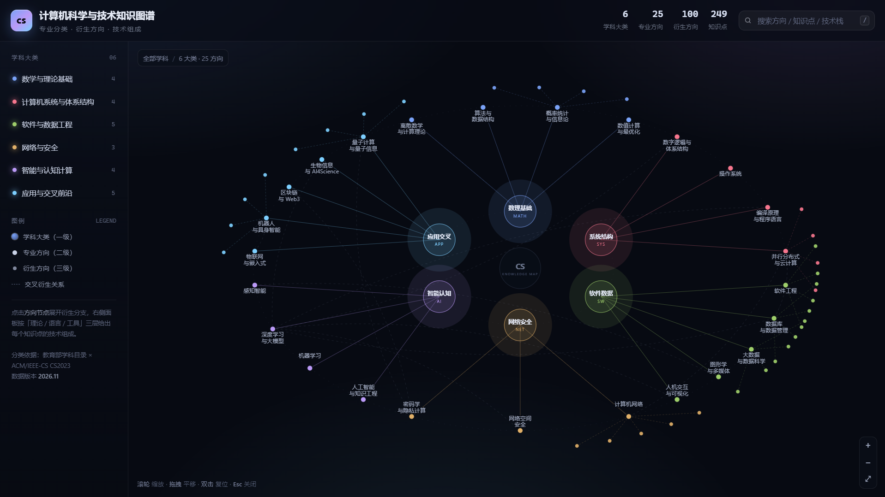

# 计算机科学与技术知识图谱



按学科目录 + 课程体系重构的四层知识地图：**6 个学科大类 → 25 个专业方向 → 100 个衍生方向 → 249 个知识点**，每个知识点都拆到「理论与方法 / 编程语言 / 框架·工具·平台」三层技术组成。

## 交付物

| 文件                         | 用途                                                                                 |
| -------------------------- | ---------------------------------------------------------------------------------- |
| `计算机科学与技术知识图谱.html`        | 交互式知识地图，双击即可离线打开（无外部依赖）。6 个大类呈放射状分布，点击方向展开衍生方向，右侧抽屉给出该方向全部知识点的技术组成；支持搜索、缩放、交叉学科跳转。 |
| `计算机科学与技术知识图谱-技术组成明细.xlsx` | 5 个工作表：总览（含统计图）、方向总览、知识点明细（249 行）、交叉衍生、技术栈索引（534 个技术条目反查所属方向）。                     |

## 分类方法

- **一级（6 类）**：在《研究生教育学科专业目录》0812 计算机科学与技术 / 0835 软件工程 / 0839 网络空间安全，以及 ACM/IEEE-CS *CS2023* 知识领域的基础上重组为：数学与理论基础、计算机系统与体系结构、软件与数据工程、网络与安全、智能与认知计算、应用与交叉前沿。
- **二级（25 个）**：对应学科目录下的研究方向与 CS2023 的知识领域（KA），保证每个方向都有独立的理论内核与工程栈。
- **三级（100 个）**：衍生方向。既包含学科自身的细分（如「事务与并发控制」），也包含交叉产生的新方向（如「向量与混合检索」「神经渲染」），后者在图中以虚线弦连接。
- **四级（249 个）**：知识点。技术组成统一为三层——
  - *理论*：该知识点依赖的模型、定理、算法与工程方法；
  - *语言*：常用的实现语言；
  - *工具*：框架、库、平台或标准。

## 工程结构

```
data/            分大类的源数据（JSON），便于逐块维护
src/template.html 页面模板（数据以占位符注入）
build.py         合并校验 -> graph.json -> 生成 HTML
build_xlsx.py    读取 graph.json -> 生成 Excel
graph.json       合并后的规范数据（脚本产物）
```

重建：

```bash
python build.py        # 校验数据并输出 HTML
python build_xlsx.py   # 输出 Excel
```

数据校验规则：方向 id 唯一、每个知识点必须具备 `n/t/l/s` 四个字段、交叉链接必须指向已存在的方向；统计数字由脚本计算，不手写。
